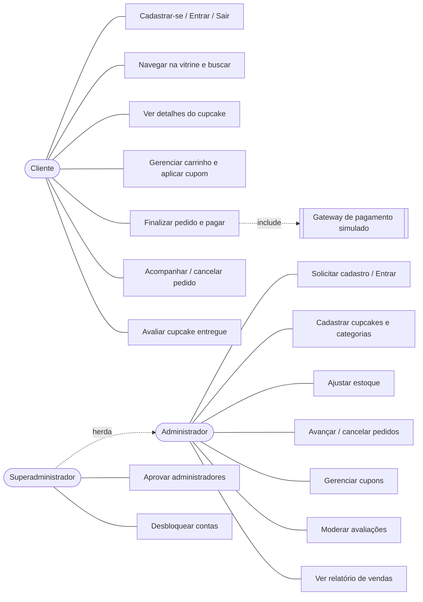
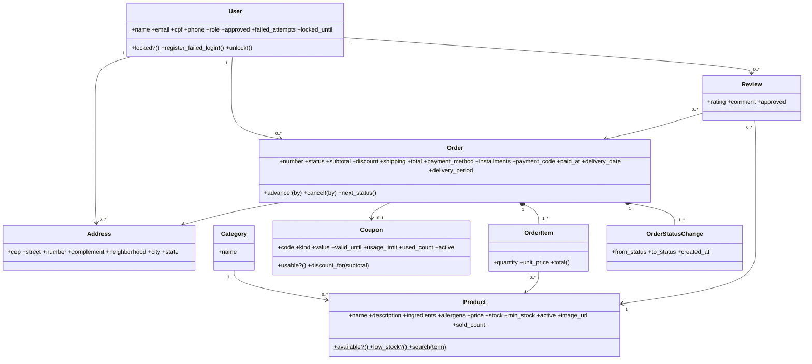
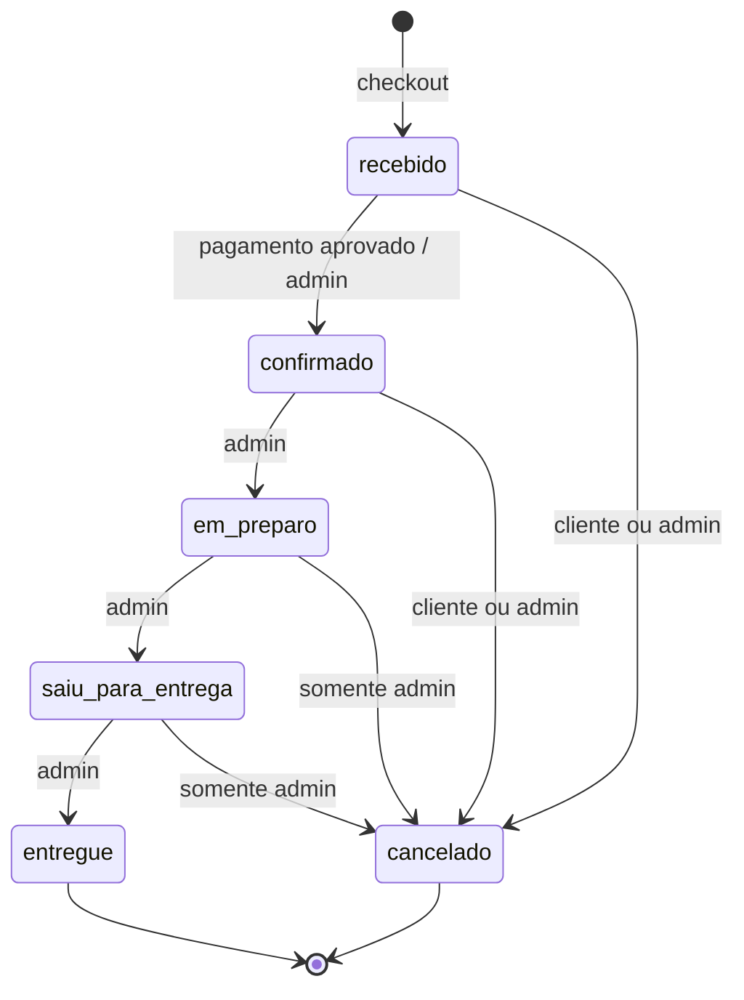
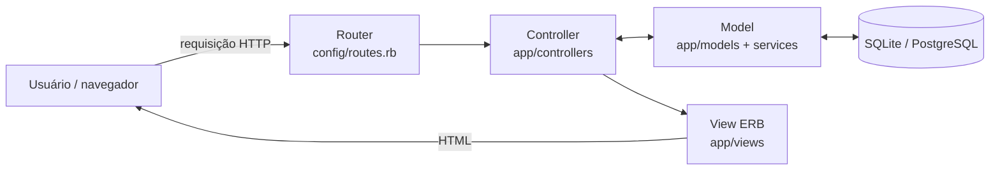

# 2. Modelagem UML

Diagramas em Mermaid (o GitHub renderiza automaticamente).

## 2.1 Casos de uso



## 2.2 Diagrama de classes (persistência)



Classes de serviço (não persistidas): `Cart` (carrinho na sessão), `Checkout` (transforma carrinho em pedido), `PaymentSimulator`, `Shipping`.

## 2.3 Sequência: finalizar pedido (US-010/US-011)

```mermaid
sequenceDiagram
  actor Cliente
  participant V as View (checkout)
  participant CC as CheckoutsController
  participant CK as Checkout (serviço)
  participant DB as Banco de dados
  participant PS as PaymentSimulator
  Cliente->>V: escolhe endereço, data, pagamento
  V->>CC: POST /checkout
  CC->>CK: call(user, cart, params)
  CK->>DB: BEGIN; SELECT products FOR UPDATE
  alt estoque insuficiente ou regra violada
    CK-->>CC: erros
    CC-->>V: re-exibe formulário com mensagens
  else ok
    CK->>DB: INSERT orders, order_items; UPDATE stock, coupon
    CK->>PS: process!(order)
    PS->>DB: status = confirmado (PIX/cartão) ou mantém recebido (boleto)
    CK->>DB: COMMIT
    CC-->>Cliente: redirect para /pedidos/:id (protocolo)
  end
```

## 2.4 Estados do pedido (US-016/US-018)



## 2.5 Atividade: arquitetura MVC da aplicação


