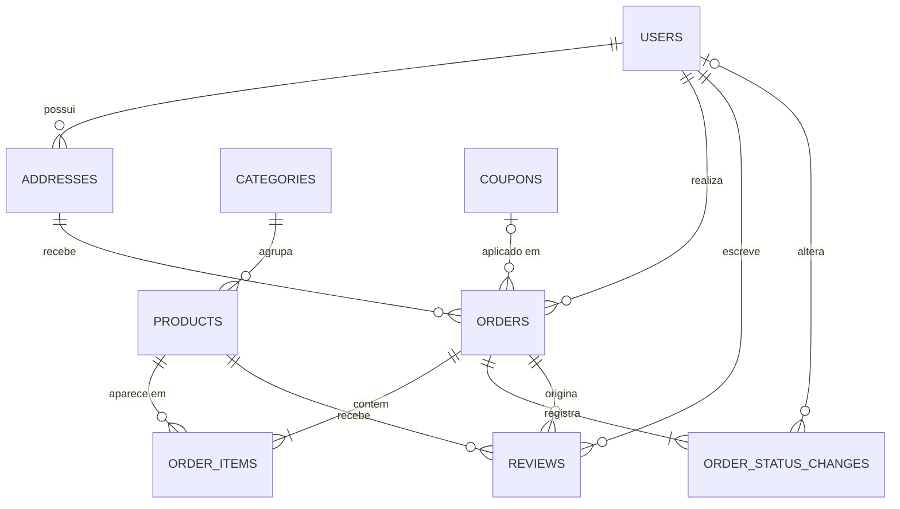

# 3. Projeto de dados

## 3.1 Projeto conceitual (DER)

## 3.2 Projeto lógico (normalizado até a 3FN)

- **users**(<u>id</u>, name, email*, password_digest, cpf*, phone, role, approved, failed_attempts, locked_until)
- **addresses**(<u>id</u>, #user_id, cep, street, number, complement, neighborhood, city, state)
- **categories**(<u>id</u>, name*)
- **products**(<u>id</u>, #category_id, name*, description, ingredients, allergens, price, stock, min_stock, active, image_url, sold_count)
- **coupons**(<u>id</u>, code*, kind, value, valid_until, usage_limit, used_count, active)
- **orders**(<u>id</u>, #user_id, #address_id, #coupon_id, number*, status, subtotal, discount, shipping, total, payment_method, installments, payment_code, paid_at, delivery_date, delivery_period)
- **order_items**(<u>id</u>, #order_id, #product_id, quantity, unit_price); único (order_id, product_id)
- **order_status_changes**(<u>id</u>, #order_id, #user_id, from_status, to_status, created_at)
- **reviews**(<u>id</u>, #user_id, #product_id, #order_id, rating, comment, approved); único (order_id, product_id)

(<u>sublinhado</u> = PK, # = FK, * = UNIQUE)

**Normalização**
- 1FN: todos os atributos são atômicos; telefones/CEP/CPF guardados só com dígitos.
- 2FN: as tabelas usam chave primária simples (`id`); o N:N pedido×produto foi resolvido por `order_items`.
- 3FN: categoria é tabela própria (não texto repetido no produto); endereço é tabela própria ligada ao cliente.
- **Desnormalizações conscientes:** `order_items.unit_price` guarda o preço da época da compra (o preço do produto pode mudar depois); `orders.subtotal/total` congelam o valor cobrado; `products.sold_count` acelera a ordenação "mais vendidos".

## 3.3 Projeto físico

- DDL completo: [`schema-fisico.sql`](schema-fisico.sql) e `db/schema.rb`; histórico em `db/migrate/`.
- Integridade garantida **no banco** (não só na aplicação): `NOT NULL`, `UNIQUE`, `FOREIGN KEY` e `CHECK` (ex.: `price > 0`, `stock >= 0`, `quantity BETWEEN 1 AND 50`, `rating BETWEEN 1 AND 5`, domínio de `status`/`role`/`payment_method`).
- Domínio ≠ tipo: por exemplo `cpf` é `varchar(11)`, mas o domínio (CPF válido) é verificado pelo dígito verificador no model.
- SGBD: SQLite em desenvolvimento/testes; PostgreSQL em produção (`DATABASE_URL`).

## 3.4 Dicionário de dados

Ver [`04-dicionario-de-dados.md`](04-dicionario-de-dados.md).
